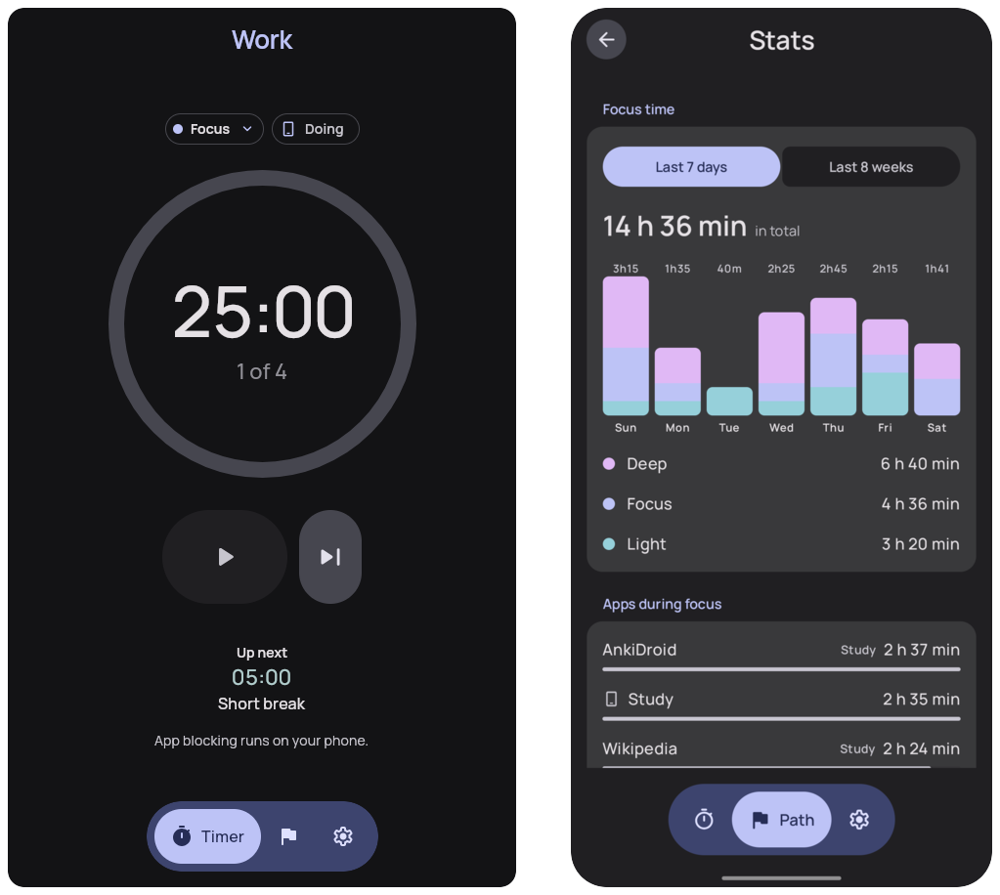
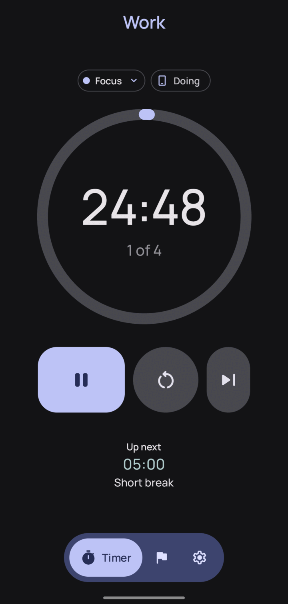
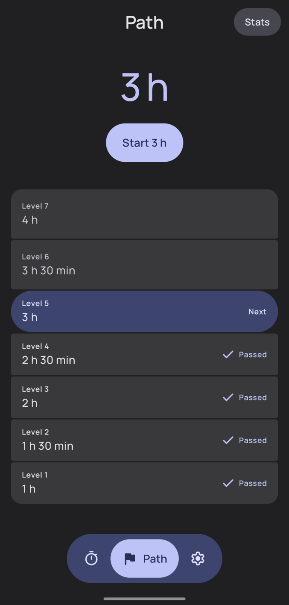
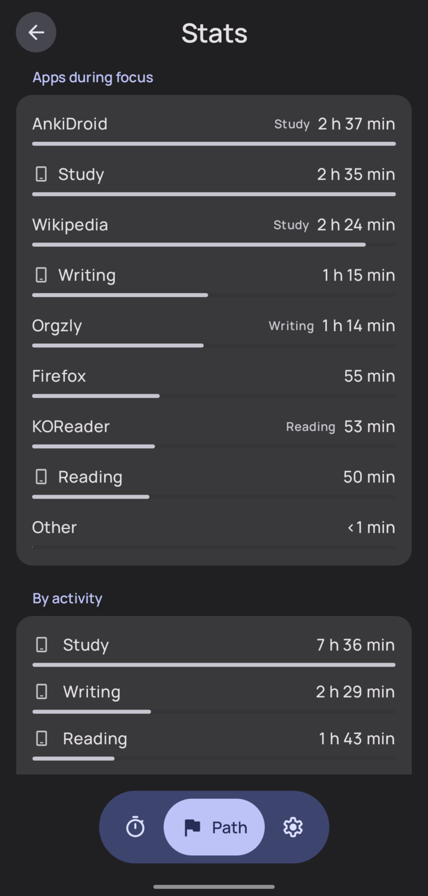
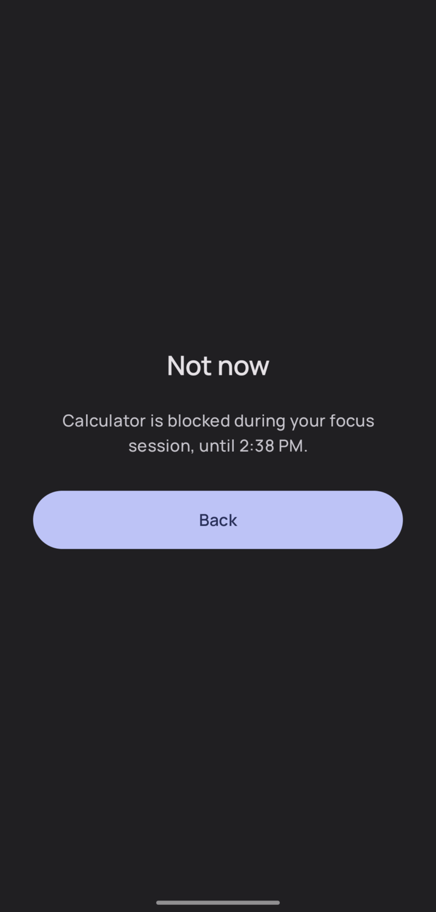

# Hush

> A vibe-coded app for my own use: I like [Tomato](https://github.com/nsh07/Tomato) but wanted a
> few extra things, and the releases are for personal use too. To contribute or donate, go to
> [Tomato](https://github.com/nsh07/Tomato) and [Curbox](https://github.com/curbox-app/curbox-android)
> instead.

A focus app for Android and Linux: a Pomodoro timer, a "detox path" of ever longer breaks from your
phone, and app blocking. No accounts; nothing goes to the internet.

  

[Download for Android](https://github.com/MoXcz/hush/releases/latest) ·
[Download for Linux](#linux-x86_64) ·
[Build from source](docs/building.md)

Hush builds on [Tomato](https://github.com/nsh07/Tomato) and
[Curbox](https://github.com/curbox-app/curbox-android); see [Credits](#credits-and-licences).

## What it does

<table>
  <tr>
    <td></td>
    <td></td>
    <td></td>
    <td></td>
  </tr>
  <tr>
    <td><b>Timer.</b> Work and break phases, with tags as presets.</td>
    <td><b>Detox path.</b> Levels from 1 h up to your goal.</td>
    <td><b>Stats.</b> The apps used during focus, by activity.</td>
    <td><b>Blocking.</b> A calm screen over the apps you block.</td>
  </tr>
</table>

- **App blocking (Android).** During a work phase or detox level, apps on your Deep work or Detox
  list get a block screen. Hush only reads which app is in front. Turn it on in Settings → App
  blocking.
- **Apps during focus.** Stats lists the apps you used during work phases. Android needs usage
  access (Settings → Timer → App usage during focus); the desktop works on Hyprland, off by default.
- **Activities.** Tap an app, site or program in Stats to sort it into an activity once
  ("Anki → Study"); "By activity" adds up the time.
- **Sync.** Phone and computer sync directly over your home network; see
  [Sync](#sync-with-your-computer).

### If blocking doesn't turn on

- **"Restricted setting".** Android blocks accessibility services from downloaded APKs. Open
  Settings → Apps → Hush, tap ⋮ → Allow restricted settings, then try again.
- **Some apps refuse to run** beside an accessibility service from outside the Play Store. Turn
  blocking off with the switch in Settings → App blocking; turning it back on opens Android's
  Accessibility settings.
- **Android 16 Advanced Protection** turns off Hush's accessibility service, so blocking is
  unavailable while Advanced Protection is on. The timer and stats still work.

## Sync with your computer

1. On the computer, open **Settings → Sync**. It shows a code like `K7QM-2F9X-HC4D` for two minutes.
2. On the phone, open **Settings → Sync**, type the code and tap **Pair**.
3. Both devices show the other's name and sync right away.

Then the phone syncs history, tags, activities and sorting rules when you open Hush and about
hourly on Wi-Fi; the computer only needs Hush open. The computer needs `avahi-daemon` running; for
firewall rules, see [docs/sync.md](docs/sync.md).

## Install

Files for each version are on the [releases page](https://github.com/MoXcz/hush/releases).

### Android (8.0 or newer)

Download `hush-<version>-arm64-v8a.apk` (almost every current phone), or the `universal` APK if
unsure, and open it. Android refuses updates signed with a different key, and uninstalling deletes
Hush's data, so keep installing from these releases.

### Linux (x86_64)

Download `hush-<version>-linux-x86_64.tar.gz`, unpack it anywhere and run `Hush/bin/Hush`. The
archive includes its own Java runtime and is built on Arch Linux. Optional: `libnotify`
(notifications), `avahi` (sync) and `hyprland` (apps during focus).

Settings and history live in `~/.config/hush` and `~/.local/share/hush`, so deleting the unpacked
folder keeps them. On Arch you can also build a pacman package from source; see
[docs/building.md](docs/building.md).

## Credits and licences

Hush is GPL-3.0-or-later ([LICENSE](LICENSE)) and derives from two GPL-3.0 projects:

- **[Tomato](https://github.com/nsh07/Tomato)** by Nishant Mishra: Hush started from Tomato's
  architecture and reuses its timer engine design, Material 3 Expressive look and motion, screen
  layouts, toolbar, Room and Koin setup, and several icons.
- **[Curbox](https://github.com/curbox-app/curbox-android)** by Nethical and Curbox contributors:
  Hush's built-in blocker is adapted from Curbox's accessibility service and always-allowed rules
  (`AppBlockerService.kt`, `AlwaysAllowed.kt` keep Curbox's copyright line).
- **Manrope** by The Manrope Project Authors, https://github.com/googlefonts/manrope, under the SIL
  Open Font License 1.1 (`shared/src/commonMain/composeResources/files/OFL-manrope.txt`).
